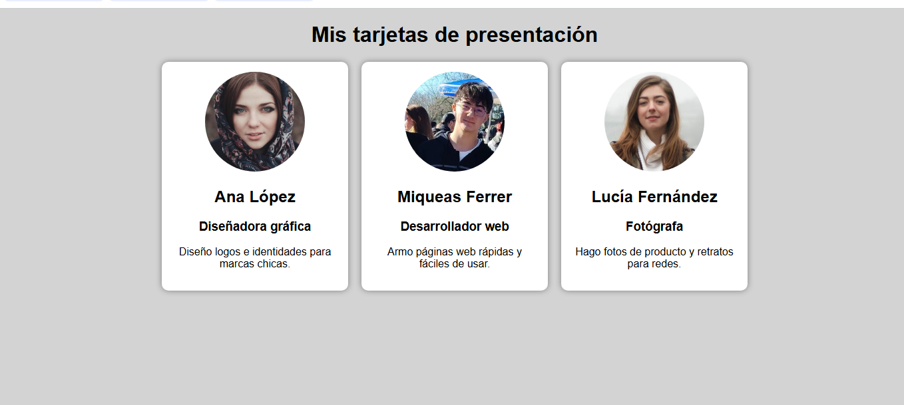

# Mi tarjeta de presentación en React

Tarea de React Inicial. Hice un componente `Tarjeta` que recibe por props el nombre, la profesión, una imagen y una descripción, y lo uso 3 veces en `App.jsx` con datos distintos.

## Cómo correrlo

```
git clone https://github.com/miqueasferrer2-ai/mi-tarjeta-react.git
cd mi-tarjeta-react
npm install
npm run dev
```

Después abrir http://localhost:5173 en el navegador.

## Capturas



## Autor

- Nombre: Miqueas Ferrer
- Curso: 4.º año, Informática
- Unidad: React Inicial, Módulo 1, Unidad 4: "Mi tarjeta de presentación en React"

## Fuentes

- React. Writing Markup with JSX. https://react.dev/learn/writing-markup-with-jsx
- React. Passing Props to a Component. https://react.dev/learn/passing-props-to-a-component

## Créditos de imágenes

- Foto de Miqueas: foto propia.
- Fotos de Ana y Lucía: avatares de ejemplo de https://pravatar.cc